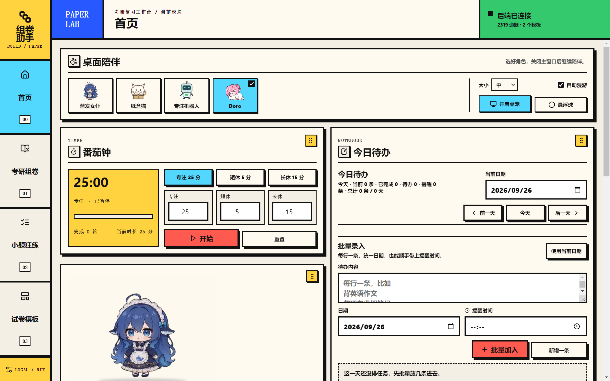
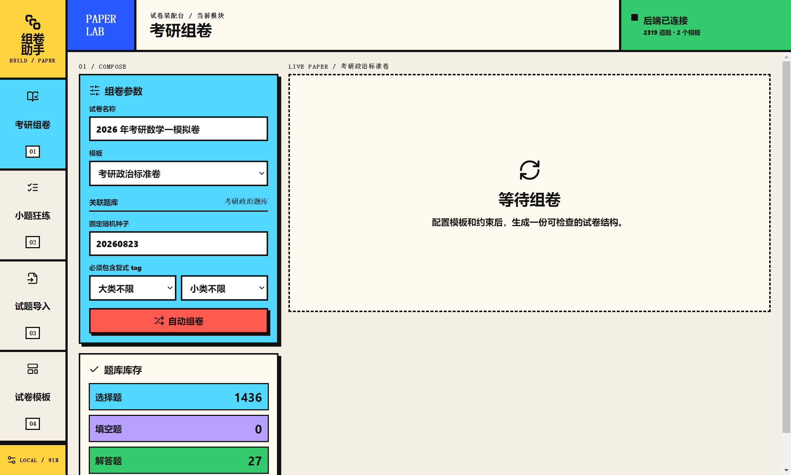
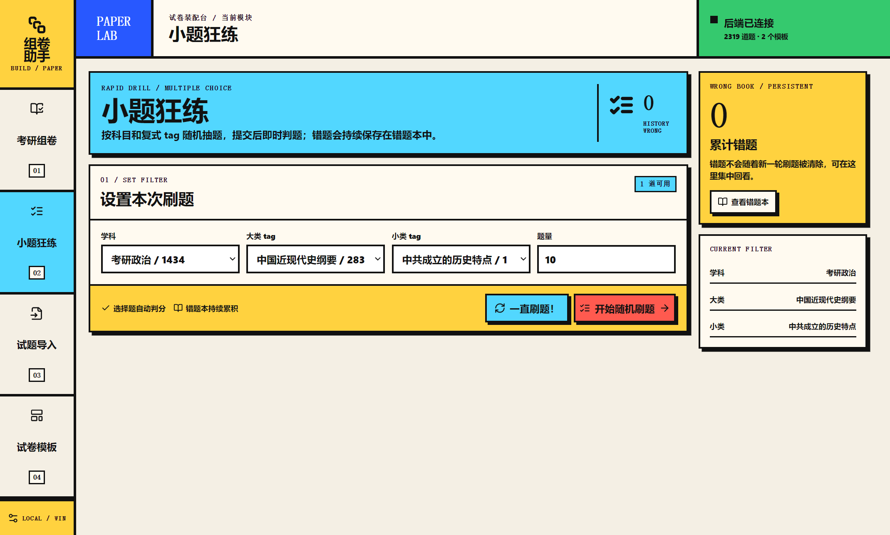
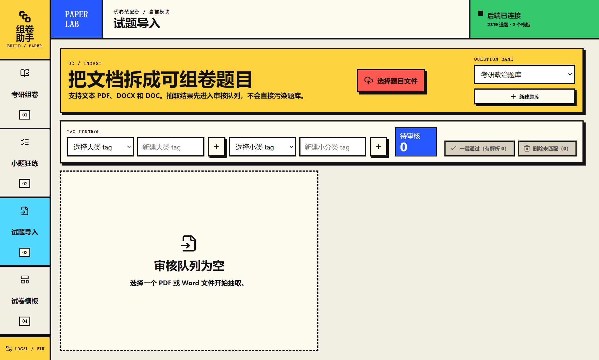
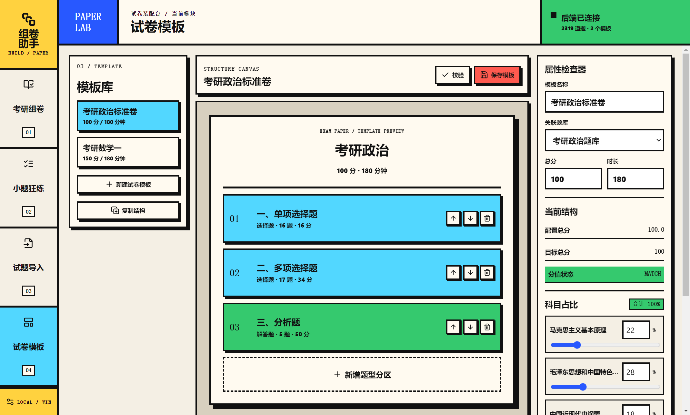

# 组卷助手 · 把复习摊开，把题做完

> 题可以不会，资料不能再找半小时。桌宠可以摸，今天的待办也得做。

备考时，电脑里最不缺的往往是资料：真题一个文件夹，解析另一个文件夹，错题截图散落各处。想认真学十分钟，先花八分钟找东西。

所以有了这个小工作台。把题库、组卷、刷题、错题、待办和番茄钟放在一起，再留个位置给桌宠。它不会替你考上，但可以少让你在一堆窗口之间来回跑。

**选一门课，开一组题，做完再说。** 想模拟考试就组卷，想补弱就按知识点筛选；累了可以点点桌宠——它还会把今天没做完的事递到你面前。陪伴是真的，催作业也是真的。

项目在本地运行，桌面端使用 Electron + React + TypeScript，后端使用 FastAPI + SQLite。

仓库随附 **8,137 道题目**、题库分类与模板，以及可独立使用的题面 / 解析图片。首次启动空数据库时自动加载，克隆项目后即可使用。

## 先安顿好今天，再跟题目过招

- **番茄钟**：专注、短休息、长休息及 1–1440 分钟自定义时长；桌宠或悬浮球旁同步显示计时，到点提醒并持续记录超时，点击结束后结算。
- **今日待办**：按日期查看、批量添加、完成状态和时间提醒。
- **工作台面板**：调整面板顺序，集中查看目标院校、题库概览与资讯。
- **桌面陪伴**：选择角色，设置大小与自动漫游，一键进入桌宠或悬浮球。

界面用了硬边框、实体阴影和平面色块。我希望它像一张摊得开的书桌：计时器、任务和题目都看得见，用起来不用猜。至于桌宠，占一点位置就占一点吧。



## 桌宠：上岸帮不上，陪你坐会儿

提供 **Doro、蓝发女仆、纸盒猫、专注机器人** 四套可替换外观。挑一个合眼缘的学习搭子；选谁都不会给题目偷偷降难度。

- 关闭主窗口后进入上次使用的桌宠 / 悬浮球模式，系统托盘可恢复窗口。
- 透明动画包含待机、行走、特殊动作与点击互动，行走之间会休息。
- 自动二维移动，碰到屏幕工作区边缘反弹；拖动、互动和隐藏时暂停位移。
- 拖动只改变位置，禁止通过边框缩放；小 / 中 / 大为 160 / 220 / 280 DIP。
- 单击桌宠播放完整互动动画，并打开屏幕右下角固定的今日剩余待办面板；长列表内部滚动，关闭面板不影响桌宠。
- 各动作按角色身体尺度统一处理，去掉额外挤压缩放；点击动画按素材时长播放，重复点击重新开始。
- 双击桌宠、单击悬浮球可回到学习台；右键切换角色、模式、大小或退出。
- 保存角色、模式、位置、大小和漫游开关；已检查 Windows 100% / 150% 双屏缩放。


浏览器可以预览角色，独立桌宠窗口需要 Electron 客户端。参数、素材来源与操作说明见 [桌面陪伴文档](docs/desktop-pet.md)。

## 题库：收藏不算会，做过才知道

### 当前随附数据

已按题目 ID 核对本地数据库和仓库 JSON，合计 **8,137 道**，含项目原有演示题。

| 题库 | 题目数 | 主要分类 |
| --- | ---: | --- |
| 考研数学一 | 1,750 | 高等数学、线性代数、概率论与数理统计 |
| 考研政治 | 1,865 | 马原、毛中特、史纲、思法、时政 |
| 计算机 408 | 4,522 | 数据结构、计算机组成原理、操作系统、计算机网络 |
| 合计 | 8,137 | 三个题库独立管理 |

408 题库包括 **4,287 道选择题、187 道综合解答题、48 道知识点简答题**。其中有 10 套自创模拟卷，共 400 道选择题和 70 道综合解答题，标注“模拟题”与卷名，可通过标签单独组卷。历年综合应用题覆盖 2009–2025 年，保留年份、题号与解答。

数学一按高等数学、线性代数、概率论与数理统计分类；政治按五个课程模块分类；408 按四科和章节分类。新增题源保留原始答案、解析和来源信息。自动分类可修订，参考解答未逐题人工重解，历史政治题按当年背景理解。

政治现有 1,808 道选择题、57 道解答题。本次从 GitHub 补充 30 道带材料与参考解答的历年分析题，沿用现有五大类与子类，可用于主观题练习和组卷。新增范围、排除记录与验收见[政治解答题补充](docs/politics-solutions-update-2026-10-15.md)。

题面、公式、图表和解析提供离线无损 WebP 预览，PDF / DOCX 导出时转换为 PNG，不依赖本机原始整册 PDF。题源、缺图排除记录与使用说明见 [GitHub 题库来源](docs/github-question-sources.md)、[408 完整性核验](docs/zhijing408-audit.json)。现已接入全部八类、125 条过程图解，以及 400 道模拟选择题的逐选项解释。

- [题目 JSON](backend/data/questions)：题干、选项、答案、解析、标签、来源区域。
- [题库清单](backend/data/bundled/manifest.json)：数量、分类、模板、来源元数据与文件校验值。
- [题面和解析图片](backend/data/bundled/previews)：按题目 ID 区分 question / analysis。

**首次启动会自动加载到空数据库，已有安装按版本补充新增题包。** 已有数据库保留原内容，不覆盖修改，也不会每次启动重新恢复已删除的题目。请完整下载 questions 和 bundled 两个目录。基础清单位于 bundled/manifest.json；408 与 GitHub 增量题包分别位于 bundled/zhijing408 和 bundled/github。

### 考研组卷 · 今天自己当出卷人

按关联模板、题型分区、复式 tag 和随机种子选题；可指定必须包含的大类 / 小类标签，生成后查看题型结构与校验状态。数学、政治与 408 使用独立题库 ID，避免混卷。



### 小题狂练 · 再来一道，这次真是最后一道

支持按题库、学科、大类和小类标签筛选，进行单选 / 多选自动判题、连续随机刷题、持久化错题记录、错题删除，以及错题和答案 PDF 导出。另有答题计时、标记、暂存恢复、收藏和错因复盘。知识地图与学习记录仪面板暂时移除，已有记录保留。

“小题狂练”内新增 **主观题练习 / 知识点阅读 / 图解浏览**。主观题提供文本与公式预览、自动草稿、提交后参考解、自评、改判与错题重练；Agent 默认关闭，手动勾选并配置 API Key 后，点击判题才调用模型并注入固定标准。知识点和图解可单独浏览，无需先答题。详见 [更新说明与验收记录](docs/subjective-diagrams-update.md)。

**到期复习**使用 FSRS 安排间隔：先回忆、看参考解，再选择忘记 / 困难 / 良好 / 轻松。支持错题自动加入、手动加入题目/知识点、撤销、暂停/恢复、暂缓、每日限额、完整历史和本地参数优化；首页及桌宠待办同步剩余任务。更新后运行 `setup.bat` 补齐调度与优化器依赖。详见 [到期复习说明与验收](docs/spaced-review-update.md)。



**408 实验台**位于“小题狂练”，提供 45 个操作系统实验，覆盖调度、页面、内存、磁盘、死锁、同步、系统调用、文件和地址转换。可改参数、逐步回放、查看图表及同参数对比；下方提供离线 C/C++ 教学代码编辑、stdin/stdout、逐行变量与关键代码讲解。使用教学解释器，支持常用语法，不生成 exe，也不代替完整 GCC/Clang。功能参照、边界和验收命令见 [408 实验台说明](docs/os-lab-update.md)。

### 导入与审核

PDF、DOCX、DOC 中抽取的题目先进入审核队列。可查看原版题面、解析匹配情况，修订题型、章节和标签，再单题或批量审核入库。导入脚本位于 scripts/。



题目采用大类 / 小类复式标签，例如：["高等数学", "函数、极限与连续"]。

### 模板与导出

模板与题库关联，支持总分、时长、题型分区、题目数、分值和大类占比。默认内置数学一、考研政治标准卷和 408 综合模拟卷。顶部“增加 408 模板套件”按需添加四科选择题训练和四个专项，重复添加不会覆盖修改。

模板可选“使用 Agent 组卷”，默认关闭；开启时弹窗填写兼容服务地址、模型及 API Key。关闭时本地规则组卷；开启时 Agent 从现有候选题中选题。Key 仅存内存，不写入数据库。详见 [Agent 组卷说明](docs/learning-agent.md)。



组卷支持“整套 PDF / Word”：一个 ZIP 包含题卷与答案册，两册使用同一份题面、答案、分值、时长与图片快照。导出前提示缺失内容；两册均生成并校验成功后才提供下载。仍可单独导出，答案、解析和评分点放在答案版。小题狂练可单独导出错题 PDF。

“用本卷时长计时”先进入准备区，确认后再开始；本次试卷时长不会覆盖日常番茄钟默认值。到点自动记录超时，收起提醒继续计时，结束后保留用时与试卷版本。操作规则、静态审阅及运行验收见[番茄钟与答案册更新](docs/pomodoro-ambient-timer-implementation-2026-10-14.md)。

## 开始使用 · 先让它跑起来

### Windows 一键启动

换一台 Windows 电脑时，先完整解压项目，再双击根目录的 **[setup.bat](setup.bat)**。首次配置会检查 Python / Node.js，缺失时尝试通过 WinGet 安装；随后创建本项目的 `.venv`、安装锁定依赖、检查 Electron，并执行类型检查与构建。看到 `Environment ready` / `Setup passed` 后，双击 **[start.bat](start.bat)** 启动。

日常 `start.bat` 仍会检查和补齐依赖，发现旧环境或缺少 `electron-vite` 会修复；任何安装失败都会停止，不再继续启动。配置与后端启动日志位于 `logs/`。完整步骤和截图报错处理见 [Windows 配置说明](docs/windows-setup.md)。

环境要求：64 位 Windows、Python 3.11+（64 位）、Node.js 20+。首次配置需要联网；无 WinGet 时需先手动安装 Python / Node.js。涉及部分 Word 转换和导出流程时需要 LibreOffice，OCR 组件也需按需另装。图片处理依赖 Pillow，已列入后端依赖。

### 手动启动

准备依赖（首次运行）：

```powershell
py -3 -m venv .venv
./.venv/Scripts/python.exe -m pip install -r backend/requirements.txt
cd frontend
npm ci --include=dev
```

在项目根目录启动后端：

```powershell
./scripts/start-backend.ps1
```

另开终端启动前端：

```powershell
cd frontend
npm run dev
```

默认前端地址为 http://127.0.0.1:5173，后端 API 为 http://127.0.0.1:8000/api。

启动日志会显示局域网访问地址。移动端浏览器使用同一主机的 8000 端口访问 API。可用 PAPER_HELPER_API_HOST、PAPER_HELPER_API_PORT、PAPER_HELPER_FRONTEND_PORT 调整监听配置；更换后端端口时需同时配置 VITE_API_BASE_URL。

## 更新随附题库

新增题包的导入、校验和构建脚本见 [题源文档](docs/github-question-sources.md)。题包清单及 WebP 是运行资产；PNG 和临时 HTML 是可再生中间文件，不提交。以下打包命令主要用于原有 PDF 裁切题库。

在本地完成题目审核入库后，运行：

```powershell
./.venv/Scripts/python.exe scripts/package_question_bundle.py
```

脚本从本地 SQLite 一致性快照读取题目，更新 JSON，按原有来源区域生成无损题面 / 解析图片，并写入清单和 SHA-256 校验值。已有且来源未改变的图片会复用；生成新图片需要原始 PDF。

提交更新时包括 backend/data/questions 与 backend/data/bundled。随附数据只包含题目、模板、题库元数据及相关裁切图片；个人错题、练习记录、待办、运行数据库和整册原始文档仍保留在本地。

## 数据与代码位置

```text
backend/
  app/
    main.py                 API、导入、审核、预览与导出
    db.py                   SQLite 初始化与迁移
    question_bundle.py      随附题库加载与原版图片读取
    composer.py              自动组卷
    practice.py              刷题与答案识别
  data/
    questions/              随仓库发布的题目 JSON
    bundled/                随仓库发布的清单与题面图片
    paper_helper.sqlite3    本地运行数据库
    documents/              本地导入原始文件
    exports/                本地 PDF / DOCX 导出
frontend/
  electron/                 桌面窗口、托盘与漫游逻辑
  src/components/           首页、桌宠、组卷、练习等界面
  public/assets/            角色素材及来源说明
scripts/
  start-backend.ps1
  package_question_bundle.py
  normalize-pet-assets.py
  capture-screenshots.cjs
```

.gitignore 仅对白名单中的 questions 与 bundled 开放数据跟踪，其他运行时数据保持忽略。桌宠设置保存到 Electron 用户数据目录的 desktop-pet.json；桌面计时保存到同目录的 focus-timer.json，并保留备份。首页待办与浏览器版计时保存在客户端本地；旧番茄钟记录首次迁移后仍保留。成套导出的快照和任务记录保存在后端数据库，生成文件位于后端导出目录。

## 认真做事的部分：校验与截图

前端构建和桌宠验证，在 frontend 目录执行：

```powershell
npm run build
node --test pet-physics.test.mjs
npm run smoke:pet
```

桌宠回归覆盖连续拖动、固定尺寸、四边反弹、双屏切换、四套角色、动画、显隐、三档大小和设置保存；使用独立临时用户数据。截图输出到 frontend/out/pet-smoke。

题库恢复与图片验证，在项目根目录执行：

```powershell
./.venv/Scripts/python.exe -m unittest discover -s backend/tests -v
```

README 截图来自真实 Electron 窗口。已有业务页面截图脚本位于 scripts/capture-screenshots.cjs，运行前需启动前后端；生成目录为 docs/screenshots。

## 文档与素材

- [新一轮 GitHub 竞品功能对比（2026-10-15）](docs/github-competitor-comparison-2026-10-15.md)
- [后续发展规划与阶段验收](docs/product-roadmap-2026-10-15.md)
- [竞品对齐逐项验收表](docs/competitor-acceptance-2026-10-15.csv)
- [Electron 首屏启动动画方案与验收](docs/startup-animation-proposal-2026-10-15.md)
- [项目设计](docs/design.md)
- [数学一题源说明](docs/math-one-sources.md)
- [桌宠操作、参数与来源](docs/desktop-pet.md)
- [番茄钟延伸设计](docs/pomodoro-ambient-timer-design-2026-10-14.md)
- [番茄钟与答案册实现、验收](docs/pomodoro-ambient-timer-implementation-2026-10-14.md)
- [Doro 来源与处理说明](frontend/public/assets/doro/SOURCE.md)

题目与图片保留各自的来源信息，原始整册 PDF / Word 不随仓库发布。第三方角色素材的许可证和来源说明保留在对应 assets 子目录；项目代码目前未单独声明开源许可证。

## 写在最后

这个项目想解决的事情很朴素：少找一次资料，少丢一道错题，让“今天学了什么”有迹可循。

题库还会补，交互还会磨，错题也不会因为换了个漂亮界面就突然变简单。如果你发现题目有误、标签跑偏，或者某个按钮实在别扭，欢迎提 Issue，最好带上题号和复现步骤。题目可以错一次，工具尽量别让你多错一次。

祝我们都能把收藏夹里的“以后学”，慢慢变成“这道我会”。
